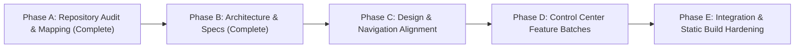

# SYNEX SaaS Platform Evolution — Implementation Plan & Phase Roadmap

## 1. Overview & Phased Strategy

### Strategic Objective
Evolve the SYNEX platform into a complete SaaS control center while strictly preserving:
1. **The 11-Act Interactive Landing Page**: Zero layout regressions or broken anchors on `/`.
2. **Next.js Static Export (`next build`)**: Clean build with 0 errors across all 36 prerendered routes.
3. **The Content Contract & Honesty Invariants**: Strict adherence to `lib/content-contract.ts` and clean prebuild audits (`npm run audit:content`).
4. **Editorial Ledger Design System**: Paper `#FBFBF9`, Ink `#121210`, Hairline `12% ink`, Amber attention, Green verification, Red violation.

---

## 2. Phase Breakdown & Execution Sequence

### Phase A: Repository Audit (Complete ✅)
- Audited route structure (36 static routes verified).
- Audited Tailwind configuration, PostCSS, and CSS loading pipeline.
- Audited fixtures (`lib/fixtures.ts`), content contracts, and motion tokens.

### Phase B: Product Specification & Planning (Complete ✅)
- Formulated `SYNEX_PLATFORM_PRODUCT_SPEC.md` mapping SaaS evolution to current codebase.
- Formulated `SYNEX_IMPLEMENTATION_PLAN.md` breaking additions into safe, independent batches.

---

### Phase C: Design & Navigation Alignment (Awaiting Approval ⏳)
*Scope: Ensure consistent navigation, shell coherence, and breadcrumb structures between the public site and the operator control center.*

1. **Batch C1 — Global Header & App Switcher Polish**:
   - Verify `components/marketing/Header.tsx` links cleanly to `/dashboard` for logged-in operators.
   - Verify role switcher in `/components/shell/TopBar.tsx` seamlessly reflects operator identity (`ops_lead`, `owner`, `viewer`).
2. **Batch C2 — Dashboard Sidebar Badges & Reactive Counters**:
   - Connect live conversation counts (`unresolvedConversations`) and failed tool executions (`actionIssues`) dynamically to sidebar badges.
   - Ensure mobile drawer on dashboard opens/closes without layout thrashing.
3. **Batch C3 — Verification Gate**:
   - Run `npm run audit:content` and `npm run build`.

---

### Phase D: Control Center Feature Evolution (Sequential Batches)

#### Batch D1: Conversations & Omnichannel Inbox UX
- **Files**: `app/dashboard/conversations/page.tsx`, `components/dashboard/ConversationDetail.tsx`
- **Features**:
  - Filter bar supporting combined Channel (`Website Chat`, `API Webhook`, `Web Form`) and Status (`all`, `active`, `needs_review`, `handoff_pending`, `resolved`).
  - Message thread display showing timestamp, sender (`buyer`, `synex`, `agent`), and typed variable extractions.
  - Context dossier drawer showing matched customer CRM data and active quote state.

#### Batch D2: Work Queue & Permission Gate Action Workbench
- **Files**: `app/dashboard/queue/page.tsx`, `app/dashboard/approvals/page.tsx`
- **Features**:
  - Interactive approval cards displaying threshold violations (e.g. $12.0\% > 8.0\%$).
  - One-click deterministic simulation buttons (`Simulate Approval (Demo)`, `Hold & Counter (Demo)`).
  - Dynamic gross margin recalculation ($19.4\% \ge 18.0\%$) before dispatch.
  - Direct sync to `CONVERSATIONS_DIRECTORY` and audit log.

#### Batch D3: Knowledge Base Authority & Conflict Workbench
- **Files**: `app/dashboard/knowledge/page.tsx`, `components/dashboard/ConflictResolver.tsx`
- **Features**:
  - Source list table displaying Authority badges (`PRIMARY` ink-filled vs `SECONDARY` hairline-bordered).
  - Interactive Conflict Resolver workbench comparing contradictory sources (e.g., Doc A ₹680 vs Doc B ₹710 on `8MM-BRS-FTG`).
  - Action buttons: `[Keep A]` or `[Keep B]` triggering `CONFLICT_RESOLVED` event and price revalidation.

#### Batch D4: Tool Execution Logs & Sovereignty Telemetry
- **Files**: `app/dashboard/actions/page.tsx`, `app/dashboard/admin/page.tsx`
- **Features**:
  - Idempotent tool execution table showing duration, payload digests, status codes, and network retry handling (preserving `504` timeout record).
  - Admin audit log viewer recording cryptographic hashes, role changes, and system settings.
  - Safe Docker Compose configuration viewer with error-guarded copy button.

#### Batch D5: Setup Wizard Polish (Onboarding)
- **Files**: `app/onboarding/page.tsx`, `components/onboarding/OnboardingWizard.tsx`
- **Features**:
  - 7-step guided workflow preserving ASCII progress bar and keyboard navigation.
  - Step 06 AI Test workbench embedding `ChatWidget` with `embedded={true}` mode.
  - Deterministic completion transition routing directly to `/dashboard`.

---

### Phase E: Verification, Performance & Honesty Hardening
1. **Automated Audit Script Execution**:
   - `npm run audit:content` $\rightarrow$ must exit 0 with 0 errors.
   - Enforce zero ungrounded production claims or unregistered security certifications.
2. **Next.js Production Build**:
   - `npm run build` $\rightarrow$ must exit 0 with all 36 static routes prerendered.
   - Homepage First Load JS strictly capped at $\le 155$ kB.
3. **Accessibility & Responsive Audit**:
   - Verify WCAG AA skip links on all views.
   - Verify `prefers-reduced-motion` compliance across all interactive elements.
   - Verify mobile viewport layout (<640px) with zero horizontal scroll.

---

## 3. Risk Mitigation & Invariant Safeguards

| Invariant / Constraint | Risk | Mitigation Strategy |
| :--- | :--- | :--- |
| **11-Act Landing Page** | Component modifications breaking public marketing presentation. | Public trace components in `components/trace/` are completely isolated from dashboard views. |
| **Static Export (`out/`)** | Introducing server-only APIs (`headers()`, `cookies()`, dynamic server routes) that fail static build. | All dashboard data operations utilize client-side React Context (`useDashboardStore`) and immutable fixtures in `lib/fixtures.ts`. |
| **Claim Honesty Contract** | Hardcoding unverified production claims in new UI screens. | Every label, sample period, and disclaimer imports directly from `lib/content-contract.ts` and is audited by `scripts/content-audit.mjs`. |
| **Tailwind & CSS Pipeline** | Modifying Tailwind config leading to unstyled UI regressions. | All new components strictly utilize defined tokens (`bg-paper`, `text-ink`, `border-hairline`, `text-amber`, `text-success`). |
