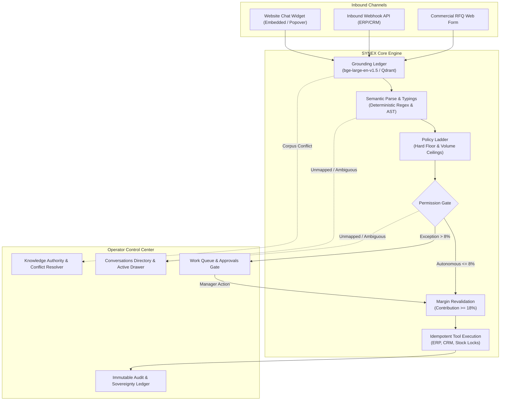

# SYNEX Platform — Master Product Specification

## 1. Executive Summary & SaaS Evolution Vision

### 1.1 The Core Proposition
SYNEX is an enterprise-grade Autonomous Commerce & Decision Control Center (currently operating in frontend prototype mode with simulated execution events). It bridges unstructured commercial interactions (inbound RFQs, chat negotiations, web inquiries) with deterministically enforced operational rules, verified multi-tier knowledge bases, and audited transactional mutations.

Unlike probabilistic conversational agents that hallucinate prices or act without boundaries, SYNEX operates under an immutable governing philosophy:
$$\text{INGEST} \longrightarrow \text{GROUND} \longrightarrow \text{PARSE} \longrightarrow \text{CHECK} \longrightarrow \text{APPROVE} \longrightarrow \text{ACT} \longrightarrow \text{AUDIT}$$

Every computational action writes an irreversible record (demonstrated via simulated immutable append-only ledgers; production cryptographic Merkle trees/HSM are planned enterprise integrations). Every discount concession evaluates hard contribution margins before dispatch. High-uncertainty queries trigger zero-cost operational handoffs to humans rather than generating ungrounded estimates.

### 1.2 The SaaS Expansion Matrix
The platform evolves from an 11-Act narrative product showcase into a multi-tenant, role-gated SaaS operating system containing two interconnected planes:
1. **The Public & Marketing Plane**: The 11-Act live execution trace, documentation, sovereign deployment limits, and commercial onboarding.
2. **The Control Center (Operator & Admin Plane)**: A high-density, keyboard-first operations workspace providing live oversight across conversations, human-in-the-loop permission gates, inventory/ERP mutations, knowledge authority resolution, and simulated cryptographic audit logs (with enterprise production attestation as an upcoming integration).

---

## 2. Platform Architecture & Data Flow

---

## 3. Core Information Architecture & Route Topology

The system comprises 36 prerendered static routes adhering to static export constraints:

### 3.1 Public & Narrative Routes
- `/`: The 11-Act Execution Trace (Act 0 Hero $\rightarrow$ Act 11 Open a Trace), Three-Step Overview Strip, Trust Control Strip, Footers, and Embedded Sovereign Chat Widget.
- `/docs`: Enterprise Documentation including Architecture Topology (`#architecture`), Terminology Glossary (`#glossary`), and Self-Hosted Deployment (`#deployment`).
- `/limits`: Non-goals, hardware boundaries, and architectural exclusions.
- `/about`: Company philosophy, founder principles, and local-first sovereign AI manifesto.
- `/changelog`: Formal ledger of platform releases (P0, P1, P2, and V1.3.x entries).
- `/partners`: Partner and integrator certified network directory.
- `/login`: Role-gated credential-free authentication simulation (`ops_lead`, `owner`, `viewer`).
- `/onboarding`: 7-Step deterministic Guided Provisioning Wizard (`Business`, `Knowledge`, `Rules`, `Actions`, `Team`, `Test AI`, `Go Live`).
- `/embed`: Standalone embeddable preview of the chat widget.

### 3.2 Operator Control Center (`/dashboard/*`)
- `/dashboard`: Executive cockpit summary (Conversations, Approvals, Knowledge Health, Margin Telemetry).
- `/dashboard/today`: *Legacy Redirect Route* $\rightarrow$ redirects cleanly to `/dashboard`.
- `/dashboard/conversations`: Filterable live communication threads (Website Chat / API Webhook / Web Form) with full message timeline and context dossier.
- `/dashboard/queue`: Unified operational task queue categorizing pending approvals, unmapped gaps, and handoffs.
- `/dashboard/approvals`: Intercepted transactions requiring Level 2 authority sign-off with dynamic margin preview.
- `/dashboard/customers`: Enterprise CRM account directory with GSTIN verification, credit limits, and historical orders.
- `/dashboard/customers/[id]`: Detailed customer record dossiers with account history and order logs.
- `/dashboard/knowledge`: Knowledge base sources repository with PRIMARY/SECONDARY authority designation, sync states, and corpus conflict resolution.
- `/dashboard/actions`: Idempotent tool execution logs showing durations, payloads, retry lifecycles, and 504 recovery.
- `/dashboard/rules`: Visual policy builder for commercial thresholds, autonomous discount limits, and role gates.
- `/dashboard/insights`: Unit economics analytics, autonomous conversion yield, and compute cost ledger.
- `/dashboard/admin`: System settings, tenant isolation profiles, local Ollama configurations, and immutable audit logs.
- `/dashboard/audit`: *Legacy Redirect Route* $\rightarrow$ redirects cleanly to `/dashboard/admin` (Audit Log tab).
- `/dashboard/handoff`: *Legacy Redirect Route* $\rightarrow$ redirects cleanly to `/dashboard/queue`.
- `/dashboard/leads`: *Legacy Redirect Route* $\rightarrow$ redirects cleanly to `/dashboard/conversations`.

---

## 4. Design System Tokens (The Editorial Ledger)

SYNEX enforces the **Editorial Ledger** visual identity across both public marketing pages and dashboard views:
- **Canvas / Paper**: `#FBFBF9` (`bg-paper`)
- **Elevated Surfaces**: `#FFFFFF` (`bg-paper-elevated`)
- **Ink Primary**: `#121210` (`text-ink`, `border-ink`)
- **Ink Muted / Secondary**: `#54565A` (`text-ink-muted`)
- **Ink Faint**: `#8A8D91` (`text-ink-faint`)
- **Hairline Borders**: `rgba(18, 18, 16, 0.12)` (`border-hairline`)
- **Attention / Gate (Amber)**: `#D97706` (`border-amber`, `text-amber`, `bg-amber-tint`)
- **Verification / Success (Green)**: `#15803D` (`text-success`, `border-success`, `bg-emerald-50`)
- **Violation / Error (Red)**: `#B3261E` (`text-error`, `border-error`, `bg-rose-50`)

### Styling Invariants
1. Zero gratuitous shadows (`box-shadow: none !important`).
2. Hairline borders (1px solid).
3. Tabular numerals (`tabular-nums`) on all monetary and statistical data.
4. Serif headings (`Newsreader` / `Source Serif 4`) paired with monospace data tags (`JetBrains Mono`).
5. Complete adherence to `prefers-reduced-motion` with instant state resolution.

---

## 5. Honesty Contract & Boundary Governance

All UI metrics, simulated logs, and integration statuses strictly adhere to `lib/content-contract.ts`:
1. **Demo Honesty**: All synthetic transactions, simulated embeddings, and demonstration benchmarks carry explicit `[DEMO]` or `[SIMULATED REPLAY]` labels.
2. **Deterministic Simulations**:
   - Act 4 policy slider follows the exact lookup table `PAUSED_SIMULATION`.
   - Act 5 permission gate executes independent margin revalidation ($19.4\% \ge 18.0\%$).
   - Act 9 isolates the conflict demonstration to `8MM-BRS-FTG` to preserve the zero-conflict guarantee of principal SKU `6MM-BRS-FTG`.
   - Act 11 displays truthful submission feedback: `"Demo submission complete — no request sent"`.
3. **Database & Infrastructure**: Local self-hosted inference (Ollama CPU-only, MySQL 8, Qdrant vector store). No claims of live cloud models or unverified certifications.
